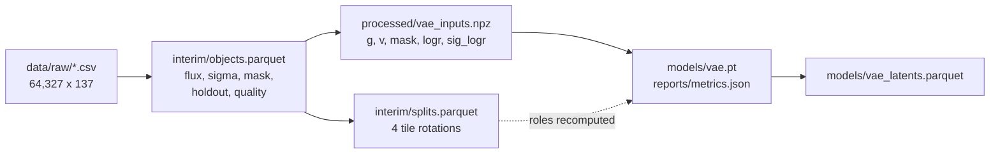

# jpas_da

Analysis of the **miniJPAS** 60-band photometry with data-science and machine-learning
methods: a spectral-energy-distribution (SED) **shape** embedding from a conditional
variational autoencoder, scored against weighted-PCA and asinh-PCA baselines.

The data are 64,293 objects observed in four overlapping pointings (tiles) in 54 narrow

+ 6 broad/medium filters. Brightness is divided out per object, so the latent describes
the *shape* of the SED given brightness; brightness itself is a condition.

| | |
| --- | --- |
| Code | `jpas_da/` — data pipeline, model, training, evaluation, cluster renderer |
| Config | `configs/vae.yaml` — every model/loss/training knob |
| Docs | this file, `references/`, and the mkdocs site (`uv run mkdocs serve`) |
| Tests | `tests/` — 113 tests, no data needed |
| Entry point | `make help` (all targets); `make check` (lint, tests, docs, pipeline) |

---

## Quick start

```bash
uv sync                       # locked environment (Python 3.10)
uv run pytest -q              # 113 tests (1 skips without the raw CSV)
make data                     # needs data/raw/...csv, see below (4 s)
make train-debug              # 1,024 objects, 2 epochs: proves the pipeline (~12 s with make data)
make train                    # rotation 0, 50 epochs
```

**The raw catalogue is not in the repository** (`data/` is git-ignored). Before
`make data`, put `data/raw/miniJpas_fluxes_errors_redshifts_full.csv`
(64,327 rows × 137 columns, 78 MB) there. It is produced by the SQL in
`references/queries/minijpas_flux_with_errors_full.txt`; see
`references/queries/README.md` for the tables, provenance and the sha256 to verify a
copy. Getting the file is the one step this repository cannot do for you.

CPU is fine. `torch` resolves to the CUDA wheel on linux-x86_64 and still imports on a
CPU-only host.

---

## Pipeline

`make data` goes from the immutable raw export to the model-ready arrays; every step is
rerunnable, deterministic, and writes under `data/`. `make train` depends on it.



| Target | What it does |
| --- | --- |
| `make data` | raw export → interim table, splits, `vae_inputs.npz` (4 s) |
| `make train` | one rotation (`data.rotation`); `DEBUG=1` for the tiny run, `CONFIG=` / `SET="--set ..."` to override |
| `make train-debug` | 1,024 objects, 2 epochs — smoke test |
| `make baselines` | weighted PCA on `g`, PCA in asinh space, sizes 4/8/16, every rotation → `reports/runs/baselines.json` |
| `make sweep` | local sweep: `STAGE=size` (latent 4/8/16 × 4 rotations) or `STAGE=ablation DIM=<d>`; resumable |
| `make report` | all runs and baselines → `reports/sweep_v2.md` |
| `make predict` | encode every object (all roles, incl. holdout) → `models/vae_latents.parquet` |
| `make run TARGET=<t> RUNNER=local\|docker\|cluster` | the same target here, in the image, or as a cluster Job |
| `make image` / `make push` | build, then push `johanmkr/jpas-da:<sha>` |
| `make smoke` / `-docker` / `-cluster` | `train-debug` + `pytest` on the host, in the image, or as a CPU Job |
| `make notebook` | open the marimo notebook in the project environment |

### Data

+ **Holdout:** the 1,168 objects with SDSS spectra are kept for label-based inference and
  never enter training, validation, testing or a fitted quantity.
+ **Quality:** `severe` objects (saturated, truncated, corrupted aperture, or near a bright
  star; 3,672) are excluded. Blends and objects outside the window frame are kept.
+ **Splits:** rotation *k* tests on tile *k*, validates on tile *k+1*, trains on the other
  two, so the test tile is never used for a choice.

Full counts and the column-by-column dictionary: `references/data_dictionary.md`.

### Normalisation

Per object, every band is divided by the broad-band brightness:

```text
r_bb     = sqrt( mean over measured {g, r, i} of f^2 )
g_j      = f_j / r_bb                                  all 60 bands
v_j      = sqrt( sigma_j^2 + (0.026 f_j)^2 ) / r_bb    0 where mask_j = 0
logr     = log r_bb,  sig_logr by the delta method
```

Narrow bands would make a poor brightness (noise is 69% of their RMS); `log r_bb` has
median S/N 6.4. No sample statistic enters, so nothing leaks across tiles.

### The model

A conditional VAE. The encoder convolves the 54 narrow bands (on their Ångström grid)
and **flattens** — no pooling, because where a feature sits in wavelength is the redshift
signal — while the six off-grid filters and `log r_bb` go through a small MLP. The decoder
maps `[z, log r_bb]` to all 60 bands. Brightness is a condition, not predicted, so the
latent describes SED shape given brightness.

The likelihood is Gaussian with known variance
`w^2 = v^2 + eps^2 + (g * sig_logr)^2`: `eps` (default 0.1) means no band is known better
than 10% of the broad-band brightness, and the last term is the shared error of `r_bb`.

```yaml
model:
  encoder: conv            # conv | mlp (flattened ablation)
  channels: [g, v, mask]   # any subset
  conditions: [logr]       # optionally sig_logr
  latent_dim: 8
loss:
  name: gaussian_nll       # gaussian_nll | student_t | mse
  beta: 1.0
  eps: 0.1
```

```bash
make train DEBUG=1 SET="--set model.latent_dim=4 --set data.rotation=2"
```

Training writes `models/vae.pt` (best epoch by validation loss, with its architecture,
channels, conditions and `eps`), `models/vae_last.pt`, and `reports/metrics.json`
(per-epoch history with KL per latent dimension, and the evaluation reports on the
validation and test tiles: χ²/dof by S/N, tile and quality, active latent dimensions).

### Weights & Biases

Training logs to W&B when `WANDB_API_KEY` is set (and `WANDB_MODE` is not
`disabled`/`offline`); without a key nothing is sent and the JSON metrics are still
written. The entity is whatever your API key defaults to, so your own account works with
no configuration; set `WANDB_ENTITY` (or `--wandb-entity`) to log into a shared team.

| Variable | Default |
| --- | --- |
| `WANDB_PROJECT` (or `--wandb-project`) | `jpas-da` |
| `WANDB_ENTITY` (or `--wandb-entity`) | the API key's default entity |
| `WANDB_RUN_NAME` | the sweep run directory, else `<encoder>-d<size>-r<rotation>` |
| `WANDB_GROUP` | none; `make sweep` sets `sweep-<variant>` |

### Results so far

20 VAE runs (latent 4/8/16 × 4 rotations, plus the MLP-encoder and `[g, mask]` ablations
at d = 8) and both baselines at the same sizes; pooled test χ²/dof, mean over rotations:

| model | d = 4 | d = 8 | d = 16 | active dims (d = 4/8/16) |
| --- | --- | --- | --- | --- |
| VAE, conv encoder | 1.390 ±0.03 | 1.400 ±0.05 | 1.434 ±0.10 | 4.0 / 3.8 / 4.2 |
| VAE, `[g, mask]` | – | 1.385 ±0.04 | – | – / 4.5 / – |
| VAE, MLP encoder | – | 1.454 ±0.07 | – | – / 5.2 / – |
| weighted PCA | 1.363 ±0.02 | 1.219 ±0.02 | 0.972 ±0.01 | – |
| asinh PCA | 1.713 ±0.07 | 1.543 ±0.03 | 1.290 ±0.03 | – |

The reading, the open questions and the reasoning: `references/pipeline-v2-plan.md`
(§ Results) and `reports/sweep_v2.md` (the generated table).

---

## Local, container, cluster: the same target

One make target runs in three places, and nothing about the pipeline changes between
them. `make run` is the switch:

```bash
make run TARGET=train-debug                 # local: uv run, host data/
make run TARGET=train-debug RUNNER=docker   # the image: /app/{data,models,reports}
make run TARGET=train RUNNER=cluster        # render + submit the cluster Job
```

| | data in | models out | reports out |
| --- | --- | --- | --- |
| local | `data/` | `models/` | `reports/` |
| container | `-v $PWD/data:/app/data` | `-v $PWD/models:/app/models` | `-v $PWD/reports:/app/reports` |
| cluster | `<PVC>/<STORAGE_ROOT>/data` → `/app/data` | `…/runs/<job>/models` → `/app/models` | `…/runs/<job>/reports` → `/app/reports` |

The pod runs `["make", "<TARGET>"]` in the same image with the same environment, so a job
names a make target, not a script path or a second copy of the arguments.

### Image

`make image` builds the CPU/GPU-agnostic image (`johanmkr/jpas-da:<git sha>`). `uv.lock`
pins `torch` from PyPI, which on linux-x86_64 is the CUDA build; it imports and runs on a
CPU-only host. `train.device: auto` therefore picks `cuda` in a GPU pod and `cpu`
everywhere else. Data is never baked in: the image has code, configs, `make`, tests and
the locked environment.

```bash
make image                                  # tag = <git sha>, or <sha>-dirty
make push                                   # build + push to Docker Hub
make push REGISTRY=<user> IMAGE_TAG=dev     # override
```

The tag carries `-dirty` while the tree has uncommitted changes, so a local build can
never be mistaken for the image of commit `<sha>`. `make push` refuses a dirty tree.

### Cluster

> **Disclaimer — the cluster setup is specific to Springfield (UiT), and it is the
> author's, not a general Kubernetes recipe.** `cluster/job.yaml.tmpl`, `make submit`,
> `make sync-up` / `sync-down` and the `frink` CLI encode Springfield's conventions: a PVC
> called `storage` mounted at `/storage`, `frink` for submission, `nvidia.com/gpu` plus
> CDI device injection, and `linux/amd64` images pulled from Docker Hub. On another
> cluster you will normally have to override `PVC`, `STORAGE_ROOT`, `FRINK` and the
> namespace handling, or skip Kubernetes entirely (`apptainer exec` / `docker run` with
> the same image and the three mounts). Nothing here has been run on a cluster other than
> Springfield. Every value is a make variable, so no file needs editing.
>
> The image itself **is** portable, and that is the part to reuse.

```bash
make sync-up                     # data/raw -> <PVC>/<STORAGE_ROOT>/data/raw
make job TARGET=train            # render cluster/jobs/train-<sha>.yaml (no contact)
make submit TARGET=train         # render + frink run
make job-logs JOB=train-<sha>    # frink logs
make sync-down JOB=train-<sha>   # models/ + reports/ back into the repo
make job-delete JOB=train-<sha>
```

Only the 78 MB raw CSV needs to reach the claim: `make train` depends on `make data`,
which rebuilds the interim table and the arrays there in about five seconds. Configs come
from the image (that is what makes `<sha>` a complete description of the run).

| Parameter | Default | Meaning |
| --- | --- | --- |
| `TARGET` / `JOB` | `train` / `$(TARGET)-$(IMAGE_TAG)` | make target, and the Job name |
| `IMAGE` | `johanmkr/jpas-da:<git sha>` | image to run; the tag records the code |
| `CONFIG` / `SET` / `DEBUG` | `configs/vae.yaml` / empty / `0` | passed as make variables, not baked into the manifest |
| `GPU_COUNT` / `GPU_DEVICES` | `1` / `0` | `GPU_COUNT=0` drops the `nvidia.com/gpu` limit; devices set `CUDA_VISIBLE_DEVICES` |
| `CPU` / `MEMORY` | `4` / `16Gi` | requests and limits |
| `DEADLINE` | `86400` | `activeDeadlineSeconds`: a stuck run cannot hold a GPU |
| `PVC` / `STORAGE_ROOT` | `storage` / `projects/jpas_da` | the claim, and the project directory inside it |
| `SPRINGFIELD` | `springfield` | `~/.ssh/config` host for the storage proxy |
| `FRINK` | `frink` | submission CLI |

`WANDB_API_KEY` comes from the `wandb-secret`/`api-key` secret when it exists
(`kubectl create secret generic wandb-secret --from-literal=api-key=…`); the pipeline runs
without it. An init container creates the `subPath` directories, because the kubelet does
not. `make smoke-docker` exercises the whole local → image → manifest chain without
contacting the cluster. Details, portability notes and how to adapt it:
`references/cluster.md`.

---

## Notebooks

Launch marimo through the project environment, never a bare `marimo`/`uvx marimo`:

```bash
uv run marimo edit notebooks/explore_data.py
make notebook NOTEBOOK=notebooks/explore_data.py
```

`uv run` puts `jpas_da` and the project dependencies on the kernel's path;
`tool.marimo.runtime.pythonpath` in `pyproject.toml` covers the package when the editable
install is missing.

The notebook follows the data from the SQL export to the arrays the VAE optimises, then
loads `models/vae.pt` and checks it against the mean-shape baseline. It needs `make data`
(and a checkpoint for its last section, which reports what is missing otherwise).

---

## Repository layout

```text
├── configs/vae.yaml       every knob of the model, loss and training loop
├── cluster/job.yaml.tmpl  the one Job manifest, rendered by jpas_da/cluster.py
├── data/                  git-ignored; raw -> interim -> processed (see above)
├── jpas_da/
│   ├── bands.py           60-band order, names and wavelengths — the single definition
│   ├── dataset.py         raw CSV -> interim table (the only irreversible step)
│   ├── splits.py          tile rotations, holdout and quality exclusions
│   ├── features.py        interim -> model arrays (broad-band RMS normalisation)
│   ├── asinh.py           asinh view, used only by the PCA baseline
│   ├── cluster.py         renders and validates the Job manifest
│   └── modeling/
│       ├── config.py      typed config, YAML + --set overrides
│       ├── data.py        the loader: roles, encoder input blocks
│       ├── vae.py         encoder trunks, latent head, decoder
│       ├── losses.py      noise model and the loss registry
│       ├── train.py       the training loop, checkpointing, W&B
│       ├── evaluate.py    χ²/dof by S/N, tile, quality; active latent dims
│       ├── baselines.py   weighted PCA and asinh PCA at the same latent size
│       ├── sweep.py       resumable local sweep driver
│       ├── predict.py     every object -> latents + per-object χ²
│       └── report.py      runs + baselines -> reports/sweep_v2.md
├── models/                git-ignored checkpoints
├── notebooks/             marimo notebook (needs `make data`)
├── references/            data dictionary, pipeline plan, derivations, queries
├── reports/               generated tables and metrics
├── tests/                 113 tests, data-free (1 skips without the raw CSV)
├── docs/                  mkdocs pages: thin wrappers that include the files above
├── Dockerfile             the portable part of the cluster story
├── Makefile               every entry point (`make help`; `make check` runs all gates)
└── mkdocs.yml             `uv run mkdocs serve` — the docs site

## Documentation

| Read this | For |
|---|---|
| `README.md` (this file) | the pipeline end to end |
| `references/getting-started.md` | clean-clone install, data, first run, troubleshooting |
| `references/queries/README.md` | where the CSV comes from, the query, sha256 |
| `references/cluster.md` | the cluster disclaimer, the image, adapting to another cluster |
| `references/data_dictionary.md` | every column, count and quality class |
| `references/pipeline-v2-plan.md` | why each design choice was made, with measurements |
| `references/vae-normalisation-and-loss.md` | the derivations behind the normaliser and the loss |
| `uv run mkdocs serve` | all of the above as one browsable site |

## License

MIT, see `LICENSE`.

