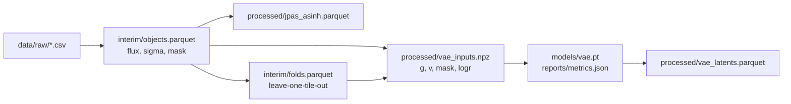

# jpas_da

<a target="_blank" href="https://cookiecutter-data-science.drivendata.org/">
    
</a>

Analysing the jpas dataset using data science methods and machine learning techniques.

## Project Organization

```
├── LICENSE            <- Open-source license if one is chosen
├── Makefile           <- Makefile with convenience commands like `make data` or `make train`
├── README.md          <- The top-level README for developers using this project.
├── data
│   ├── external       <- Data from third party sources.
│   ├── interim        <- Intermediate data that has been transformed.
│   ├── processed      <- The final, canonical data sets for modeling.
│   └── raw            <- The original, immutable data dump.
│
├── docs               <- A default mkdocs project; see www.mkdocs.org for details
│
├── models             <- Trained and serialized models, model predictions, or model summaries
│
├── notebooks          <- Jupyter notebooks. Naming convention is a number (for ordering),
│                         the creator's initials, and a short `-` delimited description, e.g.
│                         `1.0-jqp-initial-data-exploration`.
│
├── pyproject.toml     <- Project configuration file with package metadata for 
│                         jpas_da and configuration for tools like black
│
├── references         <- Data dictionaries, manuals, and all other explanatory materials.
│
├── reports            <- Generated analysis as HTML, PDF, LaTeX, etc.
│   └── figures        <- Generated graphics and figures to be used in reporting
│
├── requirements.txt   <- The requirements file for reproducing the analysis environment, e.g.
│                         generated with `pip freeze > requirements.txt`
│
├── setup.cfg          <- Configuration file for flake8
│
└── jpas_da   <- Source code for use in this project.
    │
    ├── __init__.py             <- Makes jpas_da a Python module
    │
    ├── config.py               <- Store useful variables and configuration
    │
    ├── dataset.py              <- Scripts to download or generate data
    │
    ├── features.py             <- Code to create features for modeling
    │
    ├── modeling                
    │   ├── __init__.py 
    │   ├── predict.py          <- Code to run model inference with trained models          
    │   └── train.py            <- Code to train models
    │
    └── plots.py                <- Code to create visualizations
```

--------

## Pipeline

`make data` goes from the immutable raw export to the model-ready arrays; every
step is rerunnable and writes into `data/`.



| Target | What it does |
|---|---|
| `make data` | raw export → interim object table and band scales |
| `make data` (`features`, `splits`) | asinh representation, fold assignment |
| `make model-data` | RMS shape/scale decomposition → `vae_inputs.npz` |
| `make train` | full training run (`CONFIG=...`, `SET="--set ..."`) |
| `make train-debug` | 1024 objects, 2 epochs — smoke test |
| `make predict` | encode every object into `vae_latents.parquet` |
| `make docker-build` / `make docker-train` | build the CPU image, run the debug path in it |
| `make smoke` | `train-debug` plus `pytest` |

### The model

A standard Gaussian-posterior VAE over the 60-band SED shape. The input is the
per-object RMS normalisation `g = f / ||f||` with its propagated error `v` and
the validity mask, so brightness is factored out into `log r` and handled by a
separate head; `vae-normalisation-and-loss.md` derives why. Everything is a
knob in `configs/vae.yaml`:

```yaml
model:
  channels: [g, v, mask]   # any subset of the encoder inputs
  latent_dim: 6
  hidden: [256, 128]       # one width per conv layer
  kernel_size: 5
loss:
  name: gaussian_nll       # gaussian_nll | student_t | weighted_mse | mse
```

Override without editing the file:

```bash
make train-debug SET="--set model.hidden=[64,32] --set loss.name=student_t"
```

Adding a loss is one function in `jpas_da/modeling/losses.py` plus its key in
`LOSSES`; a new channel is one entry in `jpas_da/modeling/data.py` and in
`CHANNELS`. Changing either never touches the model or the training loop.

Architecture defaults live only in `jpas_da/modeling/config.py`; `build_model`
takes every value explicitly, so training and inference cannot disagree.

Training writes `models/vae.pt` (weights, architecture, noise floor and the
resolved config) and `reports/metrics.json` (per-epoch history, final losses).

### Docker / cluster

The image is CPU by default; on a GPU node install torch from the matching CUDA
index and set `train.device: cuda` (or `--set train.device=cuda`). The image
does not contain data — mount it:

```bash
make docker-build
docker run --rm -v "$PWD/data:/app/data" -v "$PWD/models:/app/models" \
  -v "$PWD/reports:/app/reports" jpas-da:dev make train-debug
```

The image installs `make` and the locked environment; `UV_NO_SYNC=1` is set so
the container never re-resolves dependencies at run time.

### Cluster jobs

`cluster/job.yaml.tmpl` is one parametrised Kubernetes Job; `jpas_da/cluster.py`
fills it in and validates the result, and `make job` writes the manifest to
`cluster/jobs/` (git-ignored). Rendering never contacts the cluster.

```bash
make job TARGET=train IMAGE_TAG=$(git rev-parse --short HEAD)
make job TARGET=train-debug GPU_COUNT=0      # CPU smoke job
kubectl apply -f cluster/jobs/train-<sha>.yaml   # your call, not the pipeline's
```

| Parameter | Default | Meaning |
|---|---|---|
| `IMAGE` | `jpas-da:<git sha>` | image to run, tagged so the pod runs the built code |
| `TARGET` | `train` | the single make target executed in the container |
| `GPU_COUNT` | `1` | `0` omits the `nvidia.com/gpu` limit entirely |
| `CPU` / `MEMORY` | `4` / `16Gi` | requests and limits |
| `PVC` / `NAMESPACE` | `jpas-storage` / `default` | where data and outputs live |

The job mounts the claim at `/app/data` (the pipeline inputs), and writes
`models/<job>` and `reports/<job>` so concurrent runs cannot overwrite each
other. `WANDB_API_KEY` is pulled from the `wandb-api` secret when it exists; the
pipeline does not need it. `make submit`, `make job-logs` and `make job-delete`
wrap the matching `kubectl` calls.

--------

## Notebooks

Launch marimo through the project environment, never a bare `marimo`/`uvx marimo`:

```bash
uv run marimo edit notebooks/explore_data.py
# or
make notebook NOTEBOOK=notebooks/explore_data.py
```

`uv run` puts `jpas_da` and the project dependencies on the kernel's path;
`tool.marimo.runtime.pythonpath` in `pyproject.toml` covers the package when the
editable install is missing.
