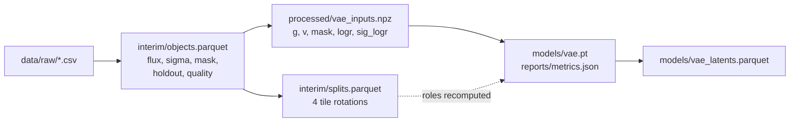

# jpas_da

<a target="_blank" href="https://cookiecutter-data-science.drivendata.org/">
    
</a>

Analysing the jpas dataset using data science methods and machine learning techniques.

## Project Organization

```
├── LICENSE            <- Open-source license if one is chosen
├── Makefile           <- Makefile with convenience commands like `make data` or `make train`
├── README.md          <- The top-level README for developers using this project.
├── data
│   ├── external       <- Data from third party sources.
│   ├── interim        <- Intermediate data that has been transformed.
│   ├── processed      <- The final, canonical data sets for modeling.
│   └── raw            <- The original, immutable data dump.
│
├── docs               <- A default mkdocs project; see www.mkdocs.org for details
│
├── models             <- Trained and serialized models, model predictions, or model summaries
│
├── notebooks          <- Jupyter notebooks. Naming convention is a number (for ordering),
│                         the creator's initials, and a short `-` delimited description, e.g.
│                         `1.0-jqp-initial-data-exploration`.
│
├── pyproject.toml     <- Project configuration file with package metadata for 
│                         jpas_da and configuration for tools like black
│
├── references         <- Data dictionaries, manuals, and all other explanatory materials.
│
├── reports            <- Generated analysis as HTML, PDF, LaTeX, etc.
│   └── figures        <- Generated graphics and figures to be used in reporting
│
├── requirements.txt   <- The requirements file for reproducing the analysis environment, e.g.
│                         generated with `pip freeze > requirements.txt`
│
├── setup.cfg          <- Configuration file for flake8
│
└── jpas_da   <- Source code for use in this project.
    │
    ├── __init__.py             <- Makes jpas_da a Python module
    │
    ├── config.py               <- Store useful variables and configuration
    │
    ├── dataset.py              <- Scripts to download or generate data
    │
    ├── features.py             <- Code to create features for modeling
    │
    ├── modeling                
    │   ├── __init__.py 
    │   ├── predict.py          <- Code to run model inference with trained models          
    │   └── train.py            <- Code to train models
    │
    └── plots.py                <- Code to create visualizations
```

--------

## Pipeline

`make data` goes from the immutable raw export to the model-ready arrays under
`data/processed/`; every step is rerunnable and writes into `data/`. `make train`
and `make train-debug` depend on it, so a clean checkout needs no manual steps.
The design and the reasons behind it are in `references/pipeline-v2-plan.md`;
every column and number is in `references/data_dictionary.md`.



| Target | What it does |
|---|---|
| `make data` | raw export → interim table, splits, `vae_inputs.npz` |
| `make train` | one rotation (`data.rotation`); `DEBUG=1` for the tiny smoke run (`CONFIG=`, `SET="--set ..."`) |
| `make train-debug` | 1024 objects, 2 epochs — smoke test |
| `make baselines` | weighted PCA on `g` and PCA in asinh space at sizes 4/8/16, every rotation → `reports/runs/baselines.json` |
| `make predict` | encode every object (all roles, incl. holdout) into `models/vae_latents.parquet` |
| `make docker-build` / `make docker-train` | build the CPU image, run the debug path in it |
| `make smoke` | `train-debug` plus `pytest` |

### Data

- **Holdout:** the 1,168 objects with SDSS spectra are kept for label-based
  inference and never enter training, validation, testing or a fitted quantity.
- **Quality:** `severe` objects (saturated, truncated, corrupted aperture, or
  near a bright star; 3,672) are excluded; blends and objects outside the
  window frame are kept.
- **Splits:** rotation *k* tests on tile *k*, validates on tile *k+1* and trains
  on the other two, so the test tile is never used for a choice.

### Normalisation

Per object, every band is divided by the broad-band brightness:

```text
r_bb     = sqrt( mean over measured {g, r, i} of f^2 )
g_j      = f_j / r_bb                                  all 60 bands
v_j      = sqrt( sigma_j^2 + (0.026 f_j)^2 ) / r_bb    0 where mask_j = 0
logr     = log r_bb,  sig_logr by the delta method
```

Narrow bands would make a poor brightness (noise is 69% of their RMS); `log
r_bb` has median S/N 6.4. No sample statistic enters, so nothing leaks across
tiles.

### The model

A conditional VAE. The encoder convolves the 54 narrow bands (on their 100 A
grid) and **flattens** -- no pooling, because where a feature sits in
wavelength is the redshift signal -- while the six off-grid filters and `log
r_bb` go through a small MLP. The decoder maps `[z, log r_bb]` to all 60 bands.
Brightness is a condition, not predicted, so the latent describes SED shape
given brightness.

The likelihood is Gaussian with known variance
`w^2 = v^2 + eps^2 + (g * sig_logr)^2`: `eps` (default 0.1) means no band is
known better than 10% of the broad-band brightness, and the last term is the
shared error of `r_bb`. Everything is a knob in `configs/vae.yaml`:

```yaml
model:
  encoder: conv            # conv | mlp (flattened ablation)
  channels: [g, v, mask]   # any subset
  conditions: [logr]       # optionally sig_logr
  latent_dim: 8
loss:
  name: gaussian_nll       # gaussian_nll | student_t | mse
  beta: 1.0
  eps: 0.1
```

Override without editing the file:

```bash
make train DEBUG=1 SET="--set model.latent_dim=4 --set data.rotation=2"
```

Training writes `models/vae.pt` (best epoch by validation loss, with its
architecture, channels, conditions and `eps`), `models/vae_last.pt`, and
`reports/metrics.json` (per-epoch history with KL per latent dimension, and the
evaluation reports on the validation and test tiles: chi2/dof by S/N, tile and
quality, active latent dimensions).

### Docker / cluster

The image is CPU by default; on a GPU node install torch from the matching CUDA
index and set `train.device: cuda` (or `--set train.device=cuda`). The image
does not contain data — mount it:

```bash
make docker-build
docker run --rm -v "$PWD/data:/app/data" -v "$PWD/models:/app/models" \
  -v "$PWD/reports:/app/reports" jpas-da:dev make train-debug
```

The image installs `make`, the test suite and the locked environment;
`UV_NO_SYNC=1` is set so the container never re-resolves dependencies at run
time. `make docker-train` is the one check this pipeline cannot run inside the
sandbox it was developed in (no Docker daemon, no `CAP_SYS_ADMIN`); run it once
on a host with Docker before trusting the image for a cluster run.

### Cluster jobs

`cluster/job.yaml.tmpl` is one parametrised Kubernetes Job; `jpas_da/cluster.py`
fills it in and validates the result, and `make job` writes the manifest to
`cluster/jobs/` (git-ignored). Rendering never contacts the cluster.

```bash
make job TARGET=train IMAGE_TAG=$(git rev-parse --short HEAD)
make job TARGET=train-debug GPU_COUNT=0      # CPU smoke job
kubectl apply -f cluster/jobs/train-<sha>.yaml   # your call, not the pipeline's
```

| Parameter | Default | Meaning |
|---|---|---|
| `IMAGE` | `jpas-da:<git sha>` | image to run, tagged so the pod runs the built code |
| `TARGET` | `train` | the single make target executed in the container |
| `GPU_COUNT` | `1` | `0` omits the `nvidia.com/gpu` limit entirely |
| `CPU` / `MEMORY` | `4` / `16Gi` | requests and limits |
| `PVC` / `NAMESPACE` | `jpas-storage` / `default` | where data and outputs live |

The job mounts the claim at `/app/data` (the pipeline inputs), and writes
`models/<job>` and `reports/<job>` so concurrent runs cannot overwrite each
other. `WANDB_API_KEY` is pulled from the `wandb-api` secret when it exists; the
pipeline does not need it. `make submit`, `make job-logs` and `make job-delete`
wrap the matching `kubectl` calls.

--------

## Notebooks

Launch marimo through the project environment, never a bare `marimo`/`uvx marimo`:

```bash
uv run marimo edit notebooks/explore_data.py
# or
make notebook NOTEBOOK=notebooks/explore_data.py
```

`uv run` puts `jpas_da` and the project dependencies on the kernel's path;
`tool.marimo.runtime.pythonpath` in `pyproject.toml` covers the package when the
editable install is missing.
