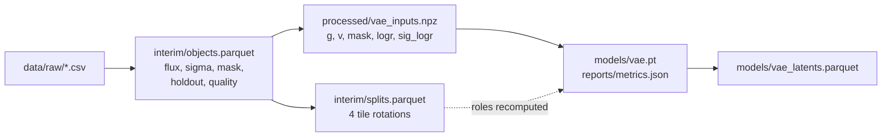

# jpas_da

<a target="_blank" href="https://cookiecutter-data-science.drivendata.org/">
    
</a>

Analysing the jpas dataset using data science methods and machine learning techniques.

## Project Organization

```
├── LICENSE            <- Open-source license if one is chosen
├── Makefile           <- Makefile with convenience commands like `make data` or `make train`
├── README.md          <- The top-level README for developers using this project.
├── data
│   ├── external       <- Data from third party sources.
│   ├── interim        <- Intermediate data that has been transformed.
│   ├── processed      <- The final, canonical data sets for modeling.
│   └── raw            <- The original, immutable data dump.
│
├── docs               <- A default mkdocs project; see www.mkdocs.org for details
│
├── models             <- Trained and serialized models, model predictions, or model summaries
│
├── notebooks          <- Jupyter notebooks. Naming convention is a number (for ordering),
│                         the creator's initials, and a short `-` delimited description, e.g.
│                         `1.0-jqp-initial-data-exploration`.
│
├── pyproject.toml     <- Project configuration file with package metadata for 
│                         jpas_da and configuration for tools like black
│
├── references         <- Data dictionaries, manuals, and all other explanatory materials.
│
├── reports            <- Generated analysis as HTML, PDF, LaTeX, etc.
│   └── figures        <- Generated graphics and figures to be used in reporting
│
├── requirements.txt   <- The requirements file for reproducing the analysis environment, e.g.
│                         generated with `pip freeze > requirements.txt`
│
├── setup.cfg          <- Configuration file for flake8
│
└── jpas_da   <- Source code for use in this project.
    │
    ├── __init__.py             <- Makes jpas_da a Python module
    │
    ├── config.py               <- Store useful variables and configuration
    │
    ├── dataset.py              <- Scripts to download or generate data
    │
    ├── features.py             <- Code to create features for modeling
    │
    ├── modeling                
    │   ├── __init__.py 
    │   ├── predict.py          <- Code to run model inference with trained models          
    │   └── train.py            <- Code to train models
    │
    └── plots.py                <- Code to create visualizations
```

--------

## Pipeline

`make data` goes from the immutable raw export to the model-ready arrays under
`data/processed/`; every step is rerunnable and writes into `data/`. `make train`
and `make train-debug` depend on it, so a clean checkout needs no manual steps.
The design and the reasons behind it are in `references/pipeline-v2-plan.md`;
every column and number is in `references/data_dictionary.md`.



| Target | What it does |
|---|---|
| `make data` | raw export → interim table, splits, `vae_inputs.npz` |
| `make train` | one rotation (`data.rotation`); `DEBUG=1` for the tiny smoke run (`CONFIG=`, `SET="--set ..."`) |
| `make train-debug` | 1024 objects, 2 epochs — smoke test |
| `make baselines` | weighted PCA on `g` and PCA in asinh space at sizes 4/8/16, every rotation → `reports/runs/baselines.json` |
| `make sweep` | local sweep: `STAGE=size` (latent 4/8/16 × 4 rotations) or `STAGE=ablation DIM=<d>`; resumable |
| `make report` | all runs and baselines → `reports/sweep_v2.md` |
| `make predict` | encode every object (all roles, incl. holdout) into `models/vae_latents.parquet` |
| `make run TARGET=<t> RUNNER=local\|docker\|cluster` | the same target here, in the image, or as a Job |
| `make image` / `make push` | build, then push `johanmkr/jpas-da:<sha>` |
| `make smoke` / `make smoke-docker` / `make smoke-cluster` | `train-debug` + `pytest` on the host, in the image, or as a CPU Job on Springfield |

### Data

- **Holdout:** the 1,168 objects with SDSS spectra are kept for label-based
  inference and never enter training, validation, testing or a fitted quantity.
- **Quality:** `severe` objects (saturated, truncated, corrupted aperture, or
  near a bright star; 3,672) are excluded; blends and objects outside the
  window frame are kept.
- **Splits:** rotation *k* tests on tile *k*, validates on tile *k+1* and trains
  on the other two, so the test tile is never used for a choice.

### Normalisation

Per object, every band is divided by the broad-band brightness:

```text
r_bb     = sqrt( mean over measured {g, r, i} of f^2 )
g_j      = f_j / r_bb                                  all 60 bands
v_j      = sqrt( sigma_j^2 + (0.026 f_j)^2 ) / r_bb    0 where mask_j = 0
logr     = log r_bb,  sig_logr by the delta method
```

Narrow bands would make a poor brightness (noise is 69% of their RMS); `log
r_bb` has median S/N 6.4. No sample statistic enters, so nothing leaks across
tiles.

### The model

A conditional VAE. The encoder convolves the 54 narrow bands (on their 100 A
grid) and **flattens** -- no pooling, because where a feature sits in
wavelength is the redshift signal -- while the six off-grid filters and `log
r_bb` go through a small MLP. The decoder maps `[z, log r_bb]` to all 60 bands.
Brightness is a condition, not predicted, so the latent describes SED shape
given brightness.

The likelihood is Gaussian with known variance
`w^2 = v^2 + eps^2 + (g * sig_logr)^2`: `eps` (default 0.1) means no band is
known better than 10% of the broad-band brightness, and the last term is the
shared error of `r_bb`. Everything is a knob in `configs/vae.yaml`:

```yaml
model:
  encoder: conv            # conv | mlp (flattened ablation)
  channels: [g, v, mask]   # any subset
  conditions: [logr]       # optionally sig_logr
  latent_dim: 8
loss:
  name: gaussian_nll       # gaussian_nll | student_t | mse
  beta: 1.0
  eps: 0.1
```

Override without editing the file:

```bash
make train DEBUG=1 SET="--set model.latent_dim=4 --set data.rotation=2"
```

Training writes `models/vae.pt` (best epoch by validation loss, with its
architecture, channels, conditions and `eps`), `models/vae_last.pt`, and
`reports/metrics.json` (per-epoch history with KL per latent dimension, and the
evaluation reports on the validation and test tiles: chi2/dof by S/N, tile and
quality, active latent dimensions).

### Weights & Biases

Training logs to W&B when `WANDB_API_KEY` is set (and `WANDB_MODE` is not
`disabled`/`offline`); without a key nothing is sent and the JSON metrics are
still written. Each epoch logs the losses, beta, the learning rate and the KL
per latent dimension; the run summary holds the best epoch and the test and
validation chi2/dof (overall, by S/N and by quality) and active dimensions.

| Variable | Default |
|---|---|
| `WANDB_PROJECT` (or `--wandb-project`) | `jpas-da` |
| `WANDB_ENTITY` (or `--wandb-entity`) | `johan-m-kroken-uit-norges-arktiske-universitet` |
| `WANDB_RUN_NAME` | the sweep run directory, else `<encoder>-d<size>-r<rotation>` |
| `WANDB_GROUP` | none; `make sweep` sets `sweep-<variant>` |

### Local, container, cluster: the same target

One make target runs in three places, and nothing about the pipeline changes
between them. `make run` is the switch:

```bash
make run TARGET=train-debug                 # local: uv run, host data/
make run TARGET=train-debug RUNNER=docker   # the image: /app/{data,models,reports}
make run TARGET=train RUNNER=cluster        # render + submit the Springfield Job
```

| | data in | models out | reports out |
|---|---|---|---|
| local | `data/` | `models/` | `reports/` |
| container | `-v $PWD/data:/app/data` | `-v $PWD/models:/app/models` | `-v $PWD/reports:/app/reports` |
| Springfield | `<PVC>/<STORAGE_ROOT>/data` → `/app/data` | `…/runs/<job>/models` → `/app/models` | `…/runs/<job>/reports` → `/app/reports` |

The pod runs `["make", "<TARGET>"]` in the same image with the same
environment, so a job names a make target, not a script path or a second copy of
the arguments.

### Image

`make image` builds the CPU/GPU-agnostic image (`johanmkr/jpas-da:<git sha>`).
`uv.lock` pins torch from PyPI, which on linux-x86_64 is the CUDA build; it
imports and runs on a CPU-only host. `train.device: auto` therefore picks `cuda`
in a GPU pod and `cpu` everywhere else. Data is never baked in: the image has
code, configs and the locked environment.

```bash
make image                                  # tag = <git sha>, or <sha>-dirty
make push                                   # build + push to Docker Hub
make push REGISTRY=<user> IMAGE_TAG=dev     # override
```

The tag carries `-dirty` while the tree has uncommitted changes, so a local
build can never be mistaken for the image of commit `<sha>`. Commit before
tagging anything you intend to keep; note that `make image` also moves
`$(IMAGE_NAME):latest` unless you pass `IMAGE_TAG`.

`make smoke-docker` runs the same smoke path as `make smoke` inside the image
and then renders the smoke Job, i.e. the whole local→cluster chain, without
contacting the cluster.

### Springfield jobs

`cluster/job.yaml.tmpl` is one parametrised Job, filled in and validated by
`jpas_da/cluster.py`; `make job` writes it to `cluster/jobs/` (git-ignored) and
`make submit` hands it to `frink`. Rendering never contacts the cluster.

```bash
make sync-up                     # data/raw -> <PVC>/<STORAGE_ROOT>/data/raw
make job TARGET=train            # render cluster/jobs/train-<sha>.yaml
make submit TARGET=train         # render + frink run
make job-logs JOB=train-<sha>    # frink logs
make sync-down JOB=train-<sha>   # models/ + reports/ back into the repo
make job-delete JOB=train-<sha>
```

Only the 78 MB raw CSV needs to reach the claim: `make train` depends on
`make data`, which rebuilds the interim table and `vae_inputs.npz` there in
about three seconds. Prebuilt tables can be mirrored instead with
`make sync-up SYNC_SRC=data/`. Configs come from the image (that is what makes
`<sha>` a complete description of the run), not from the claim.

| Parameter | Default | Meaning |
|---|---|---|
| `TARGET` / `JOB` | `train` / `$(TARGET)-$(IMAGE_TAG)` | make target, and the Job name |
| `IMAGE` | `johanmkr/jpas-da:<git sha>` | image to run; the tag records the code |
| `CONFIG` / `SET` / `DEBUG` | `configs/vae.yaml` / empty / `0` | passed as make variables, not baked into the manifest |
| `GPU_COUNT` / `GPU_DEVICES` | `1` / `0` | `GPU_COUNT=0` drops the `nvidia.com/gpu` limit; devices set `CUDA_VISIBLE_DEVICES` (CDI may leave it empty) |
| `CPU` / `MEMORY` | `4` / `16Gi` | requests and limits |
| `DEADLINE` | `86400` | `activeDeadlineSeconds`: a stuck run cannot hold a GPU |
| `PVC` / `STORAGE_ROOT` | `storage` / `projects/jpas_da` | Springfield gives every namespace a `storage` claim mounted at `/storage` |
| `SPRINGFIELD` | `springfield` | `~/.ssh/config` host for the storage proxy |

`WANDB_API_KEY` comes from the `wandb-secret`/`api-key` secret when it exists
(`kubectl create secret generic wandb-secret --from-literal=api-key=…`); the
pipeline runs without it. An init container creates the `subPath` directories,
because the kubelet does not. A first run is `make sync-up`, `make push`,
`make submit`; to pin a GPU family (gtx-1080-ti, rtx-2080-ti, rtx-3090,
rtx-A6000) or request an A6000 (>24 GB), uncomment the
`nodeSelector`/`tolerations` block at the bottom of `cluster/job.yaml.tmpl`.

--------

## Notebooks

Launch marimo through the project environment, never a bare `marimo`/`uvx marimo`:

```bash
uv run marimo edit notebooks/explore_data.py
# or
make notebook NOTEBOOK=notebooks/explore_data.py
```

`uv run` puts `jpas_da` and the project dependencies on the kernel's path;
`tool.marimo.runtime.pythonpath` in `pyproject.toml` covers the package when the
editable install is missing.
